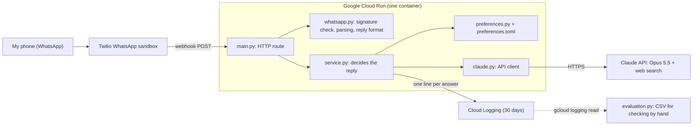
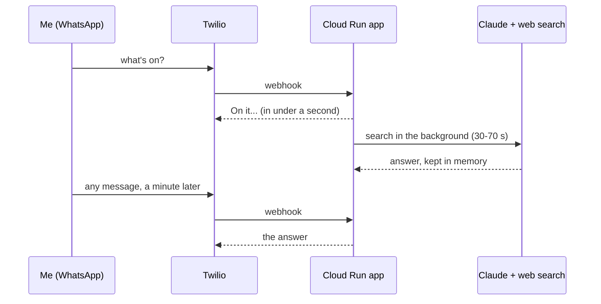

# sports_wa

A personal WhatsApp sports curator. I text "what's on?" and get today's events ranked by what I care about, the channels to watch each one on, a line on why it's worth watching, and a little-known "wildcard" sport from somewhere in the world.

It runs on Google Cloud Run and answers with Claude (Opus 5.5) using live web search. My laptop isn't involved at runtime.

A real reply, 18 October 2026:

```
Dallas Cowboys at Green Bay Packers (NFL) - 8:20 PM ET kick-off, live now
Channels: NBC / Peacock (USA)
Packers are 3-2 with one of the league's best passing attacks, and it's Jordan Love against Dak Prescott at Lambeau.

Carolina Hurricanes at Calgary Flames (NHL) - 8:00 PM ET start, live now
Channels: ESPN+ / Hurricanes Hockey Network / Sportsnet West (USA, Canada)
Carolina (7-1-1) lead the East, while Calgary (1-6) are near the bottom of the West and looking for a shock win.
```

## Architecture



The code is in layers, and each one knows as little as possible about the others:

- **`whatsapp.py`** is the only file that knows Twilio's formats. Moving to another WhatsApp provider means rewriting this one file.
- **`service.py`** holds all the logic: who gets an answer, what the prompt says, where the answer waits.
- **`claude.py`** knows the Claude API's request and response format, and nothing about sport.
- **`main.py`** only connects HTTP to the service. There is no logic in the route.

## How a question is answered

Claude needs 30 to 70 seconds to search and answer, but Twilio waits only about 15 seconds for a reply. A Twilio trial account also can't send a message later on its own. So the answer is collected with a second message:



A message sent while the search is still running gets "Still checking" and never starts a second, paid search. An answer waits 10 minutes at most, because "what's live" goes stale.

Inside the search, Claude follows a fixed order, set in the system prompt in `service.py`, with at most 10 searches:
1. A few broad searches for today's schedule, starting with the teams and competitions I follow.
2. A shortlist of 3 to 5 events, ranked: teams I follow, then tier, then how compelling the event is right now.
3. About one search per event for its channels. Each search is in the event's language, so it finds that country's broadcaster (Italian for Serie A, for example).
4. Two or three searches for a wildcard I can watch right now. The wildcard comes from a world region the app picks at random for each reply.

## Files

| File | What it does |
|---|---|
| `app/main.py` | FastAPI route `POST /webhook/whatsapp`. It checks the signature, gets a plan from the service, replies at once, and starts the background search. |
| `app/whatsapp.py` | Everything Twilio-specific: verifying the `X-Twilio-Signature`, parsing the webhook form, building the TwiML (XML) reply. |
| `app/service.py` | The logic: the system prompt, the number lock, the in-memory answer box, the call to Claude, the answer log. |
| `app/claude.py` | Calls the Claude Messages API with the web search tool, using only the standard library (`urllib`). It logs the tokens, searches and estimated cost of each call. |
| `app/preferences.py` | Reads `preferences.toml` and turns it into prompt text. |
| `preferences.toml` | What I like to watch: teams, competitions by tier, language rules, the tennis rule, wildcard rules, time zone, reply limits. Edit this file, not the code. |
| `app/evaluation.py` | Turns the answer log into a CSV sheet for checking answers by hand. |
| `tests/` | Unit tests for every module, with standard-library `unittest`. Claude and Twilio are faked, so the tests cost nothing. |
| `Dockerfile` | How Cloud Run builds the container: Python 3.12, the two dependencies, the app. |
| `.env.example` | The three secrets the app needs, with no values. |
| `.gcloudignore` | Keeps `.env` and the tests out of the upload to Google Cloud. |

## Changing what it looks for

Everything about taste lives in [`preferences.toml`](preferences.toml), not in code:

- **`team_boosts`**: teams shown whenever they play, above every tier.
- **`competitions`**: each one has a `tier` (1 is most important). Anything not listed counts as the tier after the last one.
- **`language_rules`**: which country's broadcasters to search for each event.
- **`wildcard`**: the regions to pick from and the rules for the wildcard.
- **`timezone`**, **`min_events`**, **`max_events`**, **`channels_per_event`**, **`mens_only`**: the time zone replies use, how many events, how many channels each, and whether to show only men's teams.

To add a competition:

```toml
[[competitions]]
name = "MotoGP"
tier = 2
```

Then redeploy.

## Set it up yourself

You need:
1. **An Anthropic API key**, from console.anthropic.com.
2. **A Twilio account with the WhatsApp sandbox.** In the Twilio console, go to Messaging → Try it out → Send a WhatsApp message. Send the `join ...` code from your phone to the sandbox number. Membership lasts 3 days, so re-send the code every 3 days.
3. **A Google Cloud project with billing**, and the `gcloud` command line, for example in Cloud Shell.

Copy `.env.example` to `.env` and fill it in. `.env` is git-ignored and never committed.

| Variable | What it is |
|---|---|
| `ANTHROPIC_API_KEY` | Your Claude API key. |
| `TWILIO_AUTH_TOKEN` | From the Twilio console home page. It's used to verify that requests really come from Twilio. |
| `MY_WHATSAPP_NUMBER` | The only number the bot answers, e.g. `whatsapp:+33600000000`. |

### Run the tests

```bash
pip install -r requirements-dev.txt
python3 -m unittest discover -s tests -v
```

The tests need Python 3.11 or newer, because the app uses `tomllib`. The route tests are skipped if FastAPI isn't installed.

### Run locally

```bash
set -a; . ./.env; set +a
uvicorn app.main:app --port 8080
```

Twilio can't reach a laptop without a tunnel, so the local server is only useful with fake requests. The route tests in `tests/test_main.py` send correctly signed fake requests and are the easier way to check the whole flow.

### Deploy to Google Cloud Run

Turn the filled-in `.env` into the file format Cloud Run reads, deploy, then delete that copy:

```bash
grep -E '^[A-Z_]+=' .env | sed -E 's/^([A-Z_]+)=(.*)$/\1: "\2"/' > /tmp/sports-wa-env.yaml
gcloud run deploy sports-wa --source . --region us-east1 --no-cpu-throttling --max-instances 1 --allow-unauthenticated --env-vars-file /tmp/sports-wa-env.yaml
rm /tmp/sports-wa-env.yaml
```

What the flags do:
- **`--no-cpu-throttling`** keeps the CPU on after the webhook reply, which the background search needs.
- **`--max-instances 1`** makes sure the waiting answer and your next message reach the same container.
- **`--allow-unauthenticated`** lets Twilio reach the URL. The app still rejects any request without a valid Twilio signature.

`gcloud run deploy --source .` sends the code to Google Cloud Build, which builds the container image from the `Dockerfile`. Docker isn't needed on your machine.

On a new project, the first build can fail with a 403 on `storage.objects.get`. The fix is to give the Compute Engine default service account the Cloud Run Builder role (`roles/run.builder`).

Finally, in the Twilio sandbox settings, set "When a message comes in" to `https://<your-service-url>/webhook/whatsapp`, method POST.

After a code-only change, this is enough, because the new version keeps the last one's settings and secrets:

```bash
gcloud run deploy sports-wa --source . --region us-east1
```

The service scales to zero when idle. The first message after a quiet spell takes a few seconds longer to start the container, which is still well within Twilio's limit.

## Evaluation

Every answer is logged as one line in Cloud Logging, which keeps it for 30 days: the time, the question, the wildcard region and the reply. To turn the log into a sheet, run this in Cloud Shell from the project folder:

```bash
gcloud logging read 'resource.labels.service_name="sports-wa" AND textPayload:"answer_log"' --freshness=30d --format=json | python3 -m app.evaluation > answers.csv
```

`--freshness=30d` matters: without it, gcloud only looks back one day. `cloudshell download answers.csv` saves the file to your computer, where any spreadsheet can open it.

`events_listed` and `has_wildcard` are counted automatically from the reply. Fill in the rest after checking each answer against the broadcaster's TV guide or the league's "where to watch" page:

- `events_on_today`: how many listed events really were live or on later that day
- `channels_correct`: how many listed events had their main channel right
- `ranking_ok`: y or n, whether the order felt right
- `wildcard_watchable`: y or n, whether the wildcard's `Watch:` line really showed it
- `notes`: anything wrong, in a few words

The checking is done by hand on purpose. A second Claude grading the first would search the same pages and miss the same mistakes. The cost of each answer is in the `claude ...` log line written just before it.

## Security

- **Signature check.** Every webhook must carry a valid Twilio signature (HMAC-SHA1 of the URL and form fields, keyed with the auth token). Anything else gets a 403.
- **Number lock.** Only `MY_WHATSAPP_NUMBER` gets an answer, because each answer costs money. Other numbers get silence.
- **Secrets.** They live only in `.env` locally and in Cloud Run's environment variables. They are never in git, never uploaded with the source, and never logged.
- **Sports only.** The bot declines anything that isn't about finding sport to watch.

## Cost and limits

- **Cost:** about $0.29 to $0.75 per question, measured over real runs. Ten web searches cost $0.10, and the rest is tokens: the search results are long pages. Cloud Run's own cost isn't measured yet; at a few questions a day it should be small.
- **Time:** 30 to 70 seconds per answer.
- **Accuracy:** answers come from live web search, not from Claude's memory, but channels can still be wrong. That's what the evaluation measures.
- **Restarts:** the waiting answer lives in memory, so a container restart loses it, and you ask again.
- **Twilio trial:** replies can only answer a message, which is why the answer is collected with a second message. The sandbox needs re-joining every 3 days.

## Not built yet

- No repeat of a wildcard within 14 days (needs reading back the answer log).
- Editing preferences by text message ("add MotoGP, tier 2").
- Structured sports data APIs instead of web search, for fixtures and scores.
- Moving from the Twilio sandbox to a production WhatsApp sender, which would allow one-message replies.
